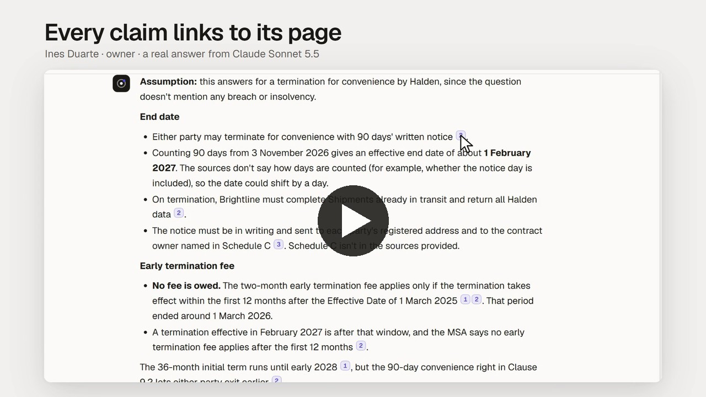
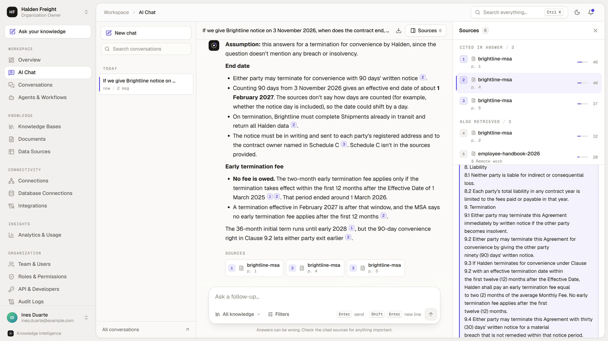
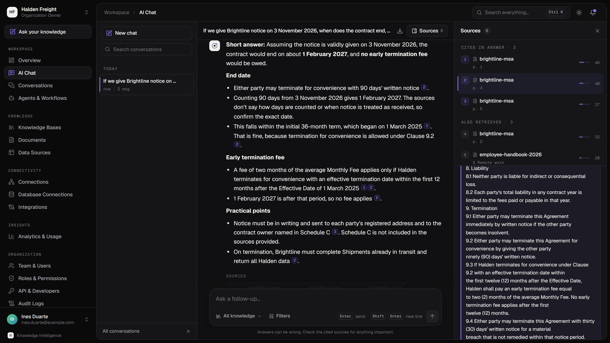
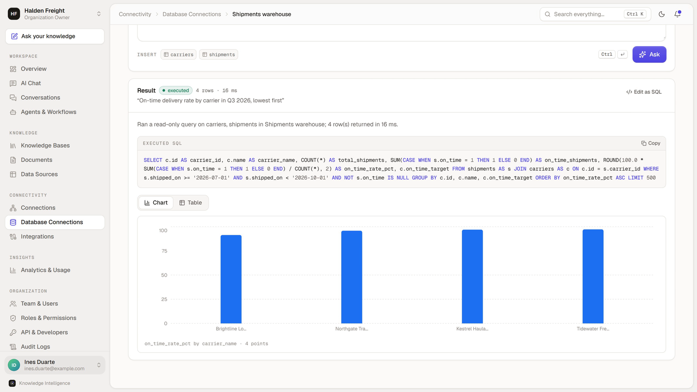
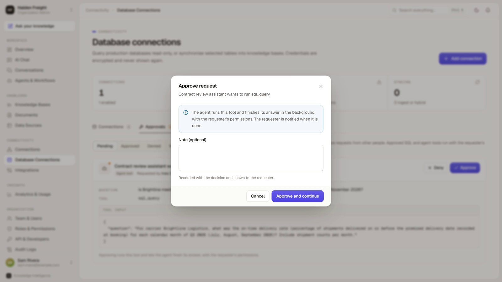
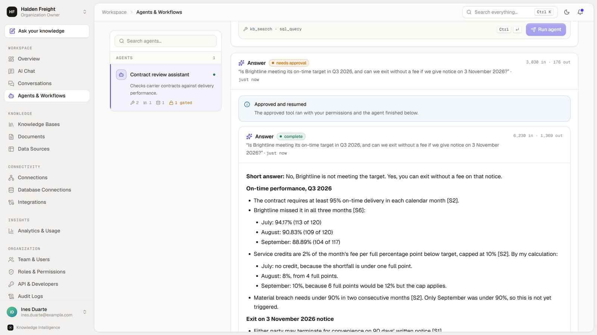
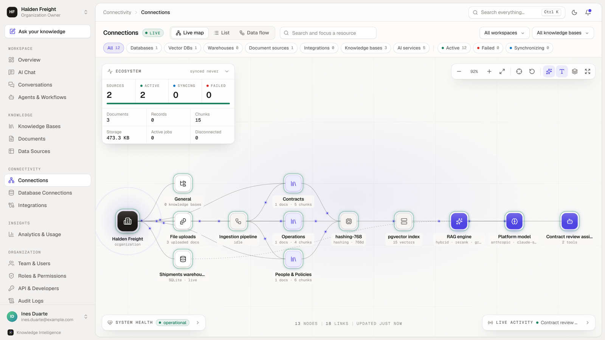

# Knowledge Intelligence

**Enterprise RAG & knowledge intelligence platform**: a multi-tenant, permission-aware knowledge platform that grew out of the CSV-AI analysis assistant. Organisations connect documents, spreadsheets, databases and web/code sources; members ask questions and get answers **grounded in sources they are allowed to see, with clickable citations** down to the page, sheet row or database query.

> Status: functional, tested end-to-end on PostgreSQL 16 + pgvector. See [IMPLEMENTATION_STATUS.md](IMPLEMENTATION_STATUS.md) for exactly what is complete, what is implemented-but-untested, and what is planned.

## Demo

[](https://youtu.be/y7RYhWfFcmA)

A 68-second walkthrough of the real app, with answers from Claude Sonnet 5.5: a cited contract answer, the same question from a member who can't see contracts, a plain-language database question, an agent that waits for an admin's approval, and the live Connections map. Halden Freight is fictional demo data. [Watch on YouTube](https://youtu.be/y7RYhWfFcmA).

## Screenshots

| | |
| --- | --- |
|  |  |
| **Cited answers.** Every claim links to its page; the Sources panel shows the passage in context. | **Light and dark themes** from one token system ([docs/DESIGN.md](docs/DESIGN.md)). |
|  |  |
| **Text-to-SQL.** A plain-language question becomes validated, read-only SQL; the result is charted. | **Approvals.** Gated agent tools wait for someone else with `db.approve`; nobody approves their own request. |
|  |  |
| **Agents resume after approval** with the requester's permissions, citing documents and live data. | **Connections map.** Sources, indexes, models and agents, built from real resources and live events. |

## Highlights

- **Multi-tenant by construction** — PostgreSQL Row-Level Security forced on every tenant table, transaction-scoped tenant context, non-superuser DB role enforced at startup, cross-tenant leakage tests.
- **Fine-grained access control** — 55 permissions, 11 predefined roles + custom roles (escalation-safe), workspace-scoped roles, grants to users/teams/departments/roles/workspaces with **deny-wins** and expiry, restricted documents, table-limited database grants. Enforced inside every retrieval query.
- **Serious RAG** — 30+ file formats with page/section/sheet/row locators, 9 chunking strategies, pgvector dense + real BM25 sparse retrieval over the authorized corpus, RRF fusion, feature reranking, MMR, query expansion, parent-child, compression, conversational query rewriting, prompt-injection screening, citation verification, honest refusals. Works offline (extractive answers) or with 10 LLM provider kinds.
- **Databases & Text-to-SQL** — connector framework (PostgreSQL & SQLite tested; MySQL/MariaDB/SQL Server/Oracle/Redshift/MongoDB beta), schema discovery, table/column selection, sensitive columns, row filters, full/incremental/scheduled sync with deletion propagation, and a sqlglot-based SQL validator with approvals.
- **CSV-AI heritage** — every uploaded CSV/XLSX/JSON/Parquet becomes a dataset with profiling, deterministic analysis, summaries and natural-language/SQL querying (DuckDB sandbox).
- **Connections command center** — a live, animated map of the organisation's data ecosystem built from real resources and real-time events (SSE), plus list and data-flow views.
- **Operations** — PostgreSQL-backed job queue with retries/dead-lettering, webhooks (HMAC-signed), scoped API keys, audit log (append-only), analytics, plan limits, platform administration without tenant content access, Docker Compose with TLS, backups.

## Quick start

**Docker (single server):**

```bash
cp .env.example .env        # fill in secrets — see DEPLOYMENT.md
docker compose up -d --build
```

**Local development (no Docker; embedded PostgreSQL):**

```bash
cd backend && python -m venv .venv && .venv/Scripts/activate && pip install -e ".[dev,local-embeddings]"
python scripts/dev.py                 # API :8000
python scripts/seed_demo.py           # optional demo data
cd ../frontend && npm install && npm run dev   # UI :3000
```

To get generated answers in development without configuring a provider in the UI, start the API with a file holding `ANTHROPIC_API_KEY` and/or `OPENAI_API_KEY` (only those keys, plus `ANTHROPIC_WORKSPACE_ID`, are read and never printed): `python scripts/dev.py --env-file ../.env.keys`. Organisations without their own provider then answer with Claude Sonnet 5.5 or GPT-5.4 mini. A local Ollama provider is available too (`seed_demo.py --ollama`), but small models on a CPU are slow and unreliable.

## Documentation

| Document | Contents |
| --- | --- |
| [ARCHITECTURE.md](ARCHITECTURE.md) | System design, tenancy, authorization model, ingestion, RAG engine, Text-to-SQL, jobs, events |
| [SECURITY.md](SECURITY.md) | Controls, RAG-specific protections, tests, known limitations |
| [DEPLOYMENT.md](DEPLOYMENT.md) | Installation, configuration, operations, backups, upgrades, troubleshooting |
| [docs/API.md](docs/API.md) | Authentication, errors, endpoint map, examples, webhooks |
| [docs/RAG_EVALUATION.md](docs/RAG_EVALUATION.md) | Evaluation method and results, incl. live Claude and OpenAI runs |
| [IMPLEMENTATION_STATUS.md](IMPLEMENTATION_STATUS.md) | Honest feature matrix |
| [docs/TESTING.md](docs/TESTING.md) | Backend tests, RAG evaluation and the browser E2E suite |
| [docs/DESIGN.md](docs/DESIGN.md) | Design system |
| [docs/ASSESSMENT.md](docs/ASSESSMENT.md) | Phase 1 assessment of CSV-AI v2 |
| [CHANGELOG.md](CHANGELOG.md) | Release notes |

## Repository

```
backend/    FastAPI app, Alembic migrations, tests (164), RAG evaluation
frontend/   Next.js 15 app (design system, 17 sections, chat, Connections map)
deploy/     Postgres init, Caddy (TLS), backup/restore
docs/       API guide, evaluation, testing, design system, assessment
```

## License

MIT — see [LICENSE](LICENSE).
